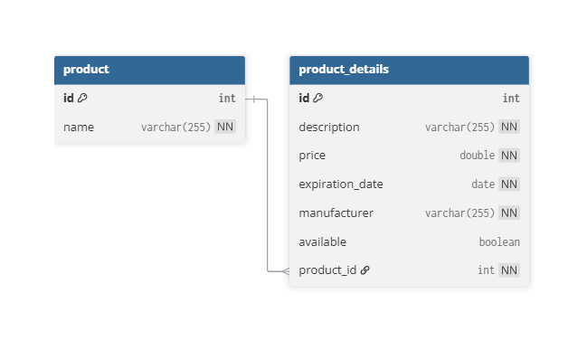
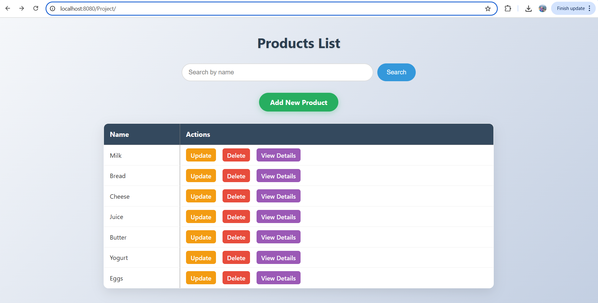
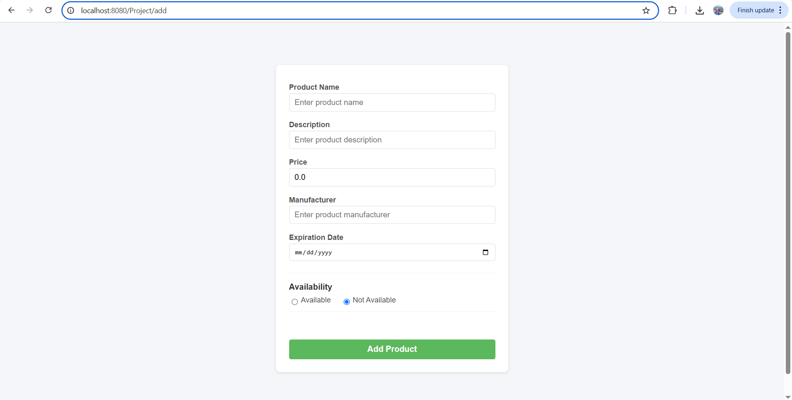
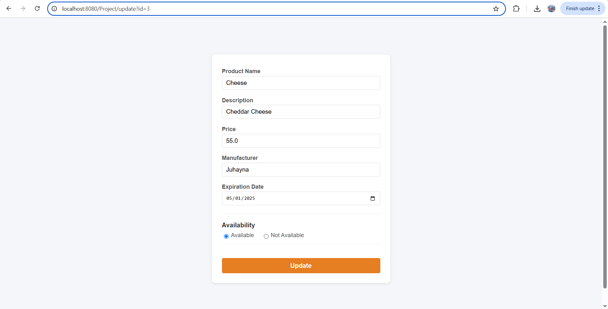
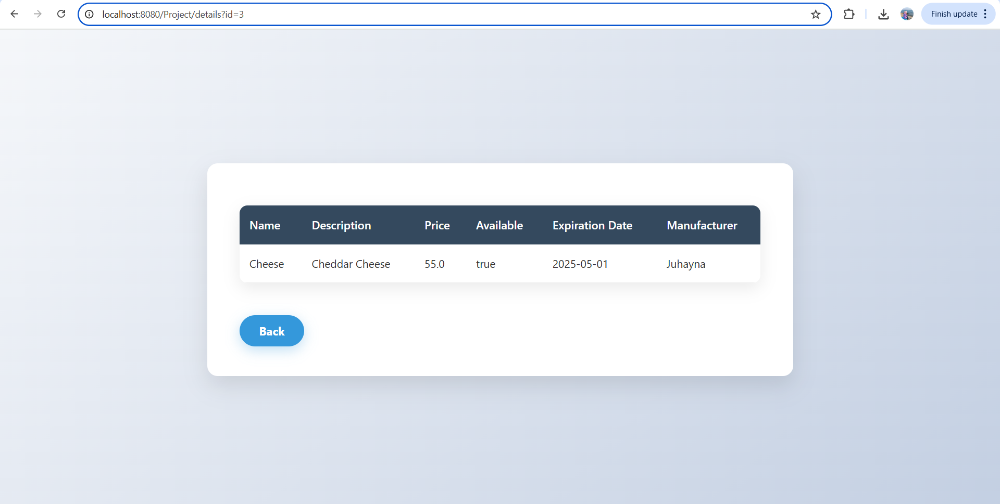
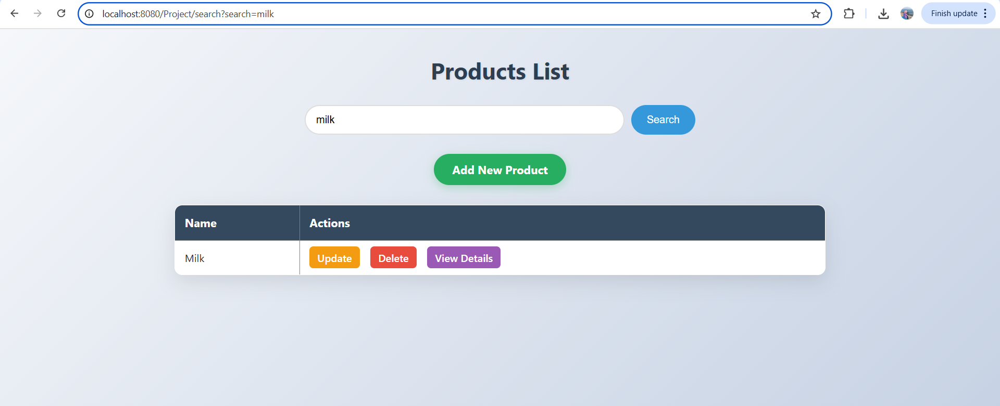

# Spring MVC Product Management System

A complete and simple admin panel built with pure Spring MVC, Hibernate, JSP, and MySQL for managing products with full CRUD operations and detailed specifications.

## Features
- List all products 
- Add new product
- Update existing product
- Delete product with confirmation
- View complete product details
- Search products by name

## Technologies Used
- Java 21
- Spring MVC
- Hibernate / JPA
- MySQL 8
- JSP (JavaServer Pages)
- Lombok
- Maven
- Apache Tomcat

## ERD

## Project Screens

**Home Page - Product List**  

**Add New Product**  

**Update Product**  

**Product Details View**  

**Search Results**  

